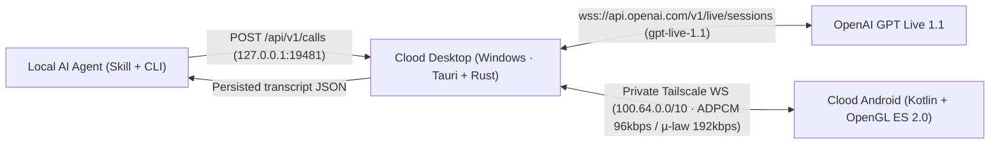

# Clood

**Private AI voice calls over Tailscale.**

Clood lets AI agents on your PC call your Android phone directly over your private Tailnet — with a native lock-screen incoming call experience, system ringtone, full-duplex **OpenAI GPT Live 1.1** voice conversation (zero internet tools), a minimalist dark luminous glass-silk orb UI, and automatic transcript return back to the calling agent.

---

## Architecture



### 100% Private Tailnet Security
- The phone server binds **exclusively** to your local Tailscale IPv4 (`100.64.0.0/10`) — never `0.0.0.0` or public/LAN interfaces.
- Incoming connections from outside the Tailscale CGNAT range are rejected at both the socket and application layers.
- Pairing via QR code (`clood://pair?...`) embeds a cryptographically random 192-bit shared secret token that can be rotated anytime from the PC app.
- Your OpenAI API key stays strictly on the PC. The phone never needs the API key or external relay servers.

---

## Features

- **Windows Desktop App (`src/`, `src-tauri/`)**:
  - Minimalist dark obsidian UI centered around a custom WebGL glass-silk orb that accelerates and illuminates as the agent speaks and rests calm when silent.
  - Configure OpenAI API key, agent display name, `gpt-live-1.1` voice, custom orb color, low-latency audio codec (`ADPCM 24 kHz · 96 kbps` or `µ-law 24 kHz · 192 kbps`), and Tailscale / local API ports.
  - Instant QR pairing, live phone connection indicator, one-click test call, system tray persistence, call transcript history, and channel-isolated in-app updates.
- **Android Companion APK (`android/`)**:
  - Native OpenGL ES 2.0 implementation of the exact same glass-silk glowing orb shader.
  - CameraX + ZXing offline QR scanner with Tailscale CGNAT validation.
  - Persistent Tailscale background connection (zero Firebase / cloud relay).
  - Real native incoming call screen with `CallStyle` full-screen intent, screen-off / lock-screen wake-up, actual device ringtone & vibration, hardware echo cancellation (`AEC`/`NS`/`AGC`), mute, and speaker/earpiece toggle.
  - Built-in channel-isolated update checker with SHA-256 verification.
- **Agent Skill (`skill/clood/`)**:
  - Ready-to-use skill instructions (`SKILL.md`), REST API reference (`references/api.md`), and a zero-dependency Python 3 CLI (`scripts/clood_call.py`) so agents can summarize context, dial your phone, wait for the call to finish, receive the saved transcript, and act on your decisions.

---

## Quick Start

### 1. Install
Download the latest Windows installer (`.exe`) and Android companion (`.apk`) from [Releases](https://github.com/MusicMaster4/clood/releases).

### 2. Configure on PC
1. Ensure [Tailscale](https://tailscale.com) is running on both your PC and your Android phone (signed into the same Tailnet).
2. Open **Clood** on Windows and open **Settings** (sliders icon) to add your OpenAI API key, choose your agent name, `gpt-live-1.1` voice, and orb color.
3. Open **Pair** (QR icon) to display your private Tailscale QR code.

### 3. Pair Android
1. Open **Clood** on Android and grant microphone, notification, and lock-screen call permissions.
2. Tap the **QR** icon and scan the QR code shown on your PC.
3. Tap the **Phone** icon on your PC for an instant test call.

---

## Local Agent API

Clood exposes a loopback-only HTTP API at `http://127.0.0.1:19481`:

| Endpoint | Description |
| --- | --- |
| `GET /api/v1/health` | Liveness probe |
| `GET /api/v1/status` | Tailscale, phone connection, OpenAI readiness, active call |
| `POST /api/v1/calls` | Start a call with `context` (`wait: true` blocks and returns the full transcript) |
| `GET /api/v1/calls/{id}` | Fetch live or persisted call record & transcript |
| `GET /api/v1/calls/{id}/wait` | Block until the call terminates and return the transcript |
| `GET /api/v1/calls` | List saved call transcripts |
| `POST /api/v1/calls/{id}/hangup` | End an active call |

### Agent Skill
The ready-to-install agent skill lives in [`skill/clood/`](skill/clood/):
- [`skill/clood/SKILL.md`](skill/clood/SKILL.md)
- [`skill/clood/scripts/clood_call.py`](skill/clood/scripts/clood_call.py)
- [`skill/clood/references/api.md`](skill/clood/references/api.md)

---

## Release Channels & Updates

Clood uses two strictly isolated release channels powered by GitHub Actions:

| Branch | Channel | Version Format | Update Endpoint |
| --- | --- | --- | --- |
| `main` | **Stable** | `vX.Y.Z` | `/releases/latest/download/{latest.json,android-update.json}` |
| `testing` | **Beta** | `vX.Y.Z-testing.N` | `/releases/download/channel-testing/{latest.json,android-update-beta.json}` |

Stable installs never see beta releases, and beta installs track only the `testing` branch. Every push to `main` or `testing` automatically compiles and publishes both the Windows `.exe` installer and the signed Android `.apk`.

---

## Repository Structure

```text
clood/
├── .github/workflows/     # CI and dual-channel Windows + Android release workflows
├── src/                   # Desktop React + TypeScript + WebGL orb UI
├── src-tauri/             # Desktop Rust backend (Tailscale server, GPT Live 1.1 bridge, Agent API)
├── android/               # Native Kotlin Android companion (OpenGL ES 2.0 orb, incoming calls, updater)
├── scripts/               # Channel versioning and release manifest generators
└── skill/clood/           # Agent skill instructions, API reference, and CLI helper
```

---

## License

[MIT](LICENSE)
